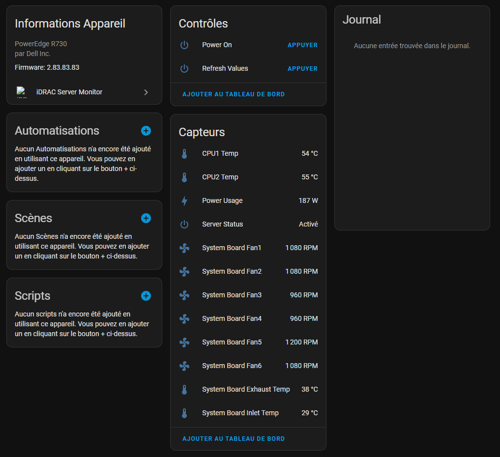

# iDRAC power monitor

[](https://github.com/hacs/integration)

Monitor and control Dell PowerEdge servers from Home Assistant through their iDRAC, from **iDRAC 6 to iDRAC 9**:

- Server power state, with power on / graceful shutdown (switch and buttons), and forced power off / forced restart buttons for a hung server or one without an operating system to answer the shutdown request
- Power usage (W) and cumulative energy consumption (kWh, usable in the Energy dashboard)
- Per power supply power usage, energy consumption and input current, so that each PSU can be counted under the plug or UPS it hangs from (see [Power supplies](#power-supplies))
- Temperatures and fan speeds
- Hardware health, per power supply health and PSU redundancy (problem sensors, e.g. to shut down when a PSU loses input)
- System Event Log: the newest record, a problem sensor while the log holds a warning or a critical record (a failed drive, a lost power supply), a button to clear it, and an `idrac_power_event` event for every new record

No extra Python dependency: everything goes through the iDRAC's own HTTPS APIs.

## Supported iDRACs

| iDRAC | API used | Notes |
|---|---|---|
| iDRAC 9 | Redfish | Recent firmware (no `/Power` / `/Thermal`) handled through `EnvironmentMetrics`, `ThermalSubsystem` and `Sensors`. Energy from Redfish, or from the iDRAC web API when Redfish lacks it. |
| iDRAC 7 / 8 | Redfish, energy from the web GUI API | If Redfish is missing (old firmware) or disabled, the web GUI API is used for everything. |
| iDRAC 6 | Web GUI API (`/data`) | iDRAC 6 has no Redfish. Old TLS (1.0) and small keys are accepted. |

The API is detected when the server is added and remembered.

> **Note on iDRAC 6 sessions:** an iDRAC 6 only accepts a few simultaneous web sessions. The integration keeps a single one open and closes it when unloaded. If adding the server fails with "all its sessions are in use", log out of the iDRAC web interface (or wait for the idle sessions to expire) and try again.

## Installation

> **Note**
>
> This integration requires [HACS](https://github.com/hacs/integration) to be installed

1. Open HACS
2. `+ EXPLORE & DOWNLOAD REPOSITORIES`
3. Find `iDRAC power monitor` in this list
4. `DOWNLOAD THIS REPOSITORY WITH HACS`
5. `DOWNLOAD`
6. Restart Home Assistant (_Settings_ > _System_ > _RESTART_)
7. _Settings_ > _Devices & services_ > _Add integration_ > `iDRAC power monitor`
8. Enter the IP address or hostname of the iDRAC, its username (`root` by default) and password (`calvin` by default).

Host, username and password can be changed later with _Reconfigure_ on the integration entry; the polling interval with _Configure_.

## Power supplies

For each power supply the iDRAC measures, there are "PS 1 power usage" (W) and "PS 1 energy consumption" (kWh) sensors, and on iDRAC 6 "PS 1 input current" (A, diagnostic; Redfish has no per-PSU current). With two PSUs fed from two different plugs or UPSs, declare each PSU's energy sensor as _included in_ the device it hangs from in the Energy dashboard, instead of the server's own energy sensor.

The iDRAC measures the power of the whole server; per PSU it only tells how the load is spread (the input current, in 0.1 A steps, on iDRAC 6; the input power on iDRAC 7/8/9 through Redfish). Multiplying a current by the line voltage gives apparent power, not real power: 0.5 A at 240 V on each PSU makes 240 VA on a server that draws 217 W. Each PSU therefore gets its share of the measured total, and PS 1 + PS 2 always equal the server, so nothing is counted twice:

- while the PSUs report their load: in proportion to it (0.5 A and 0.5 A: 108.5 W each of 217 W);
- otherwise (server off: the iDRAC reports no current), the standby power split equally between the PSUs the iDRAC lists. A powered-off server sometimes answers without any sensor: the per-PSU sensors are then unavailable, rather than guessing how many PSUs it has.

Each increase of the server's energy counter is split the same way, with the shares in force over that interval. The per-PSU energy totals are kept across Home Assistant restarts and never go down, even when the iDRAC counter is reset; energy used while Home Assistant was stopped is split when it starts again. iDRACs that report no per-PSU reading (iDRAC 7/8 through the web API, recent iDRAC 9 firmware without the Redfish `Power` resource) get no per-PSU sensors.

"PSU redundancy" is on (problem) when the power supplies are no longer redundant, and unknown while the server is off.

## Event log notifications

Every new System Event Log record fires an `idrac_power_event` event (`name`, `host`, `serial`, `severity` = `ok` / `warning` / `critical`, `time`, `message`). The records already in the log when Home Assistant starts are not announced again. For example:

```yaml
automation:
  - alias: iDRAC event log
    triggers:
      - trigger: event
        event_type: idrac_power_event
        event_data:
          severity: critical
    actions:
      - action: notify.notify
        data:
          title: "{{ trigger.event.data.name }}"
          message: "{{ trigger.event.data.message }}"
```

"Event log problem" stays on until the log is cleared with the "Clear event log" button, as the server's own front panel does. The log is read at most once a minute, whatever the polling interval.

## Troubleshooting

If an iDRAC 6 entry goes unavailable with "answered with data for another request" in the log, its web server has fallen out of step and hands every request an earlier answer. Reset the iDRAC (web interface, or `racadm racreset soft` over SSH): the server itself is not affected.


`scripts/idrac_probe.py` queries an iDRAC with the integration's own code and prints what it reads (`--raw` adds the XML of the iDRAC 6 web API). Run it from a clone of this repository in an environment where Home Assistant is installed, and attach its output to issues about missing or wrong readings:

```
python scripts/idrac_probe.py 192.168.1.120 root calvin --raw
```

## Screenshots



## Changelog

### Unreleased
- Per power supply "power usage" (W), "energy consumption" (kWh, for the Energy dashboard) and "input current" (A, diagnostic) sensors: each PSU gets its share of the power and energy the iDRAC measures for the whole server, in proportion to the PSU input currents (iDRAC 6, `ampReading`) or input power (Redfish `PowerSupplies[].PowerInputWatts`), equally while the server is off. The PSU totals always add up to the server's, and the energy totals are kept across restarts and counter resets (see [Power supplies](#power-supplies))
- New "PSU redundancy" problem sensor. iDRAC 6 lists the redundancy sensor among the power supplies (firmware 2.92 names it "system board PS redundancydancy"), and it showed up as a PSU problem sensor of that name: that entity is no longer created and can be deleted from _Settings_ > _Entities_
- The new entities' names are translated (English, French, German, Dutch, Portuguese); existing entities and their unique ids are unchanged
- Verified against real answers of an R510 (running) and three R710s (powered off), iDRAC6 2.92; the Redfish part follows Dell's documented `Power` resource and has not been tried on hardware yet
- System Event Log: "Last event" sensor (newest record; the ten latest as attributes), "Event log problem" sensor (on while the log holds a warning or critical record), "Clear event log" button, and an `idrac_power_event` event per new record for notifications. iDRAC 6 through the GUI's log export, iDRAC 7/8/9 through Redfish `LogServices/Sel`. Read at most once a minute; a failed read keeps the last log instead of failing the poll
- iDRAC 6: every answer is checked against its request. An iDRAC whose web server has fallen out of step (seen on a real R710, answering each request with the one two requests earlier) now makes the entities unavailable instead of publishing another request's data
- Verified on a real R510 and three R710s (iDRAC6 2.92): logs with drive faults and power supply losses read in about a second

### 2.0.0
- iDRAC 6 support through the iDRAC web GUI API, without any new dependency (upstream #32, supersedes upstream PR #44 which needed IPMI)
  - verified on real PowerEdge R510 and R710 (iDRAC6 firmware 2.92): power from the `systemLevel` sensor shown on the iDRAC power page (`pmReading`/`ipowerWatts1` only cover part of the load), energy from the power tracking counter (`ptsReadingc1`, kWh), standby power from the one-minute average while the host is off
- Fan, temperature, power supply and health entities appear when the server is powered on, for servers added while off (the iDRAC publishes no sensors then)
- New entries are titled with the service tag, to tell identical servers apart
- iDRAC 7/8 without Redfish (old firmware, or Redfish disabled) now fall back to the same web API instead of failing
- iDRAC 9: fans and temperatures from `ThermalSubsystem`/`Sensors` when `/Thermal` is missing or incomplete, power and energy from `EnvironmentMetrics` (upstream #19, #36, based on upstream PR #38 with its odata path bug fixed and without the hardcoded model list)
- "Server status" and the power switch now follow the host power state; they used the chassis health state and showed "running" on powered-off servers (upstream #19)
- New hardware health and per power supply problem sensors (upstream #25, #29)
- A powered-off iDRAC 6 reports its power supplies as "Unknown"; they read as unknown rather than as a problem
- Force power off and Force restart buttons, which cut the power or hard-reset the server without asking its operating system (Redfish `ForceOff` / `ForceRestart`, iDRAC 6 `pwState` 0 / 3); power on, graceful shutdown and both forced actions verified on a real R710 (iDRAC6 2.92)
- Host, username and password can be changed with _Reconfigure_, the polling interval with _Configure_; expired credentials trigger a re-authentication prompt (upstream #37)
- A pasted `https://…` URL is accepted as host; a server can no longer be added twice
- The HTTP session is released with `detach()` instead of being closed, as it shares Home Assistant's connector
- Energy: no more `sysmgmt` login on every poll when Redfish already provides the counter; the energy sensor is only created when the iDRAC provides energy data
- Rewritten on Home Assistant's `DataUpdateCoordinator` and `aiohttp`: no more blocking `requests` calls, 45 s request timeout instead of 300 s, entities become unavailable when the iDRAC is unreachable
- Entity unique ids are unchanged: upgrading keeps entity ids and history (friendly names lose the duplicated model, e.g. "PowerEdge R720 Power usage")

### 1.7.0
- Add firmware version detection to disable legacy `/data` endpoint on iDRAC 9 firmware 7.x+ (fixes #41)
- Prefer Redfish `PowerMetrics.EnergyConsumedKWh` for energy consumption over legacy endpoint
- Fix error log spam on firmware that removed the `/data/login` endpoint
- Fix potential `NameError` in legacy endpoint logout when login fails

### 1.6.1
- Fix firmware version overwriting device info, causing platform setup failures on concurrent load
- Fix power sensor showing "unavailable" instead of 0W when server is in standby
- Fix binary status sensor showing "unavailable" instead of "off" when server is powered down
- Add `async_unload_entry` to properly stop background polling and clean up on integration reload
